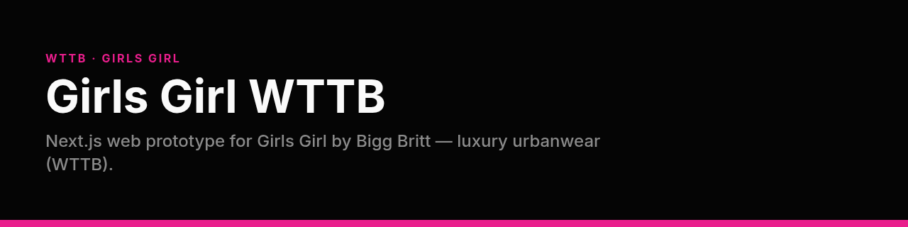

<p align="center">
  
</p>

# Girls Girl WTTB

**Next.js web prototype for Girls Girl by Bigg Britt — luxury urbanwear (WTTB).**

[](#license)


This repo is a responsive UI prototype with a mock catalog. Production target (native iOS + Medusa + Appwrite + API gateway) is described in `CursorPK.md`. Design tokens live in `DESIGN.md`.

## Features

- Shop, product detail, bag, style feed, and profile screens
- Brand tokens: near-black, pink accent `#e91e8c`, champagne tertiary
- Gateway / Appwrite env hooks via `.env.example`

## Tech stack

- Next.js 15 + React + TypeScript
- Tailwind CSS
- lucide-react

## How to run

```bash
npm install
npm run dev
npm run build
```

Read `CursorPK.md` §0 before coding.

## Environment variables

Names only. Never commit values.

- `NEXT_PUBLIC_GATEWAY_URL`
- `NEXT_PUBLIC_APPWRITE_ENDPOINT`
- `NEXT_PUBLIC_APPWRITE_PROJECT_ID`
- `NEXT_PUBLIC_API_MODE`

## Status

Public. UI prototype with mock catalog. Native/production stack not in this repo yet.

## License

All rights reserved.
